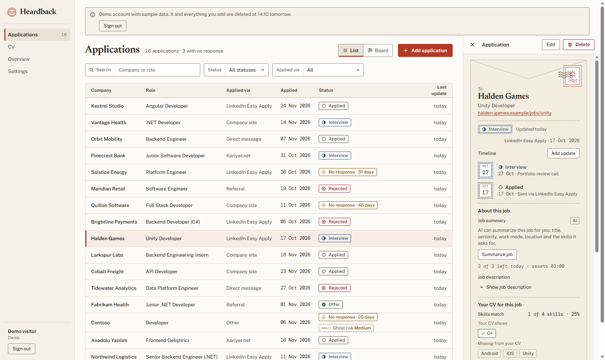
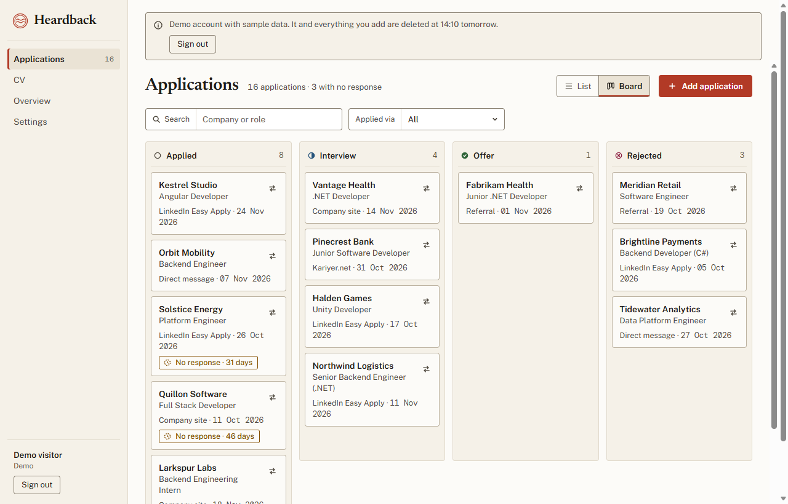
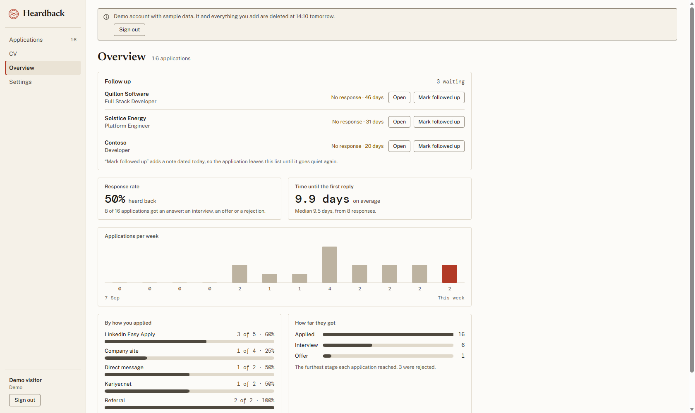
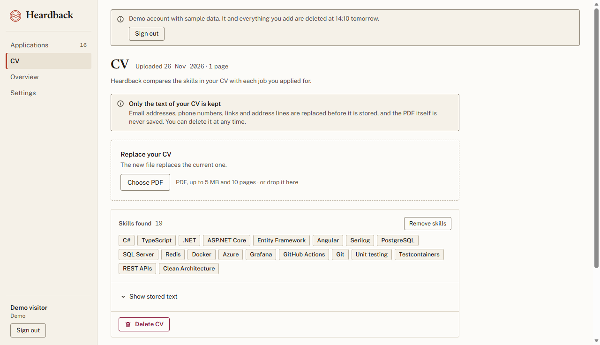
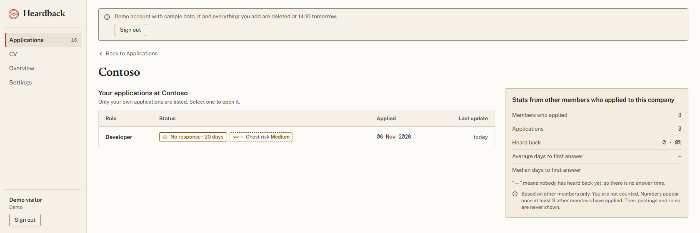
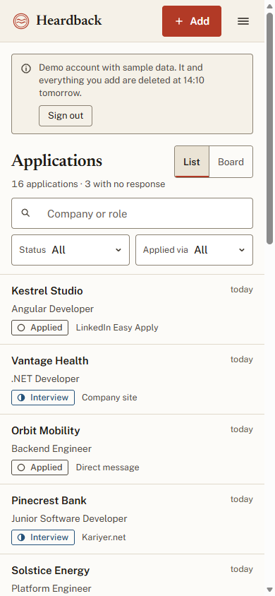
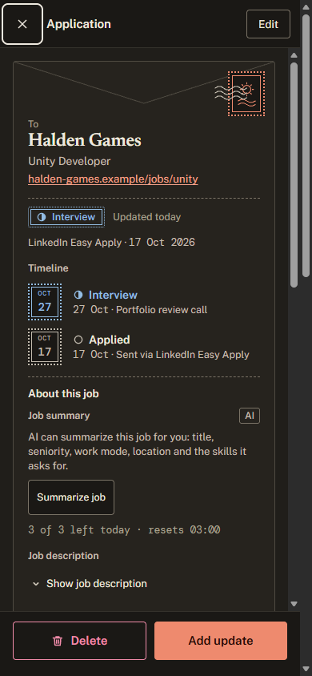
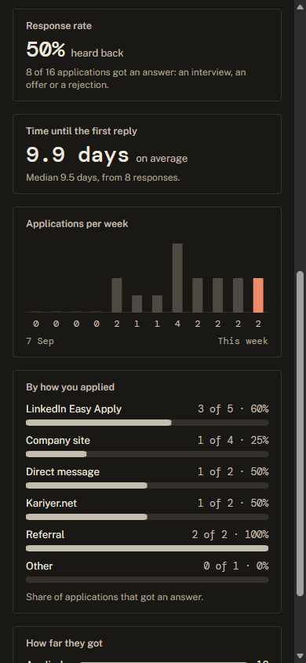
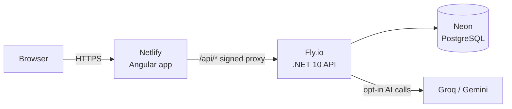
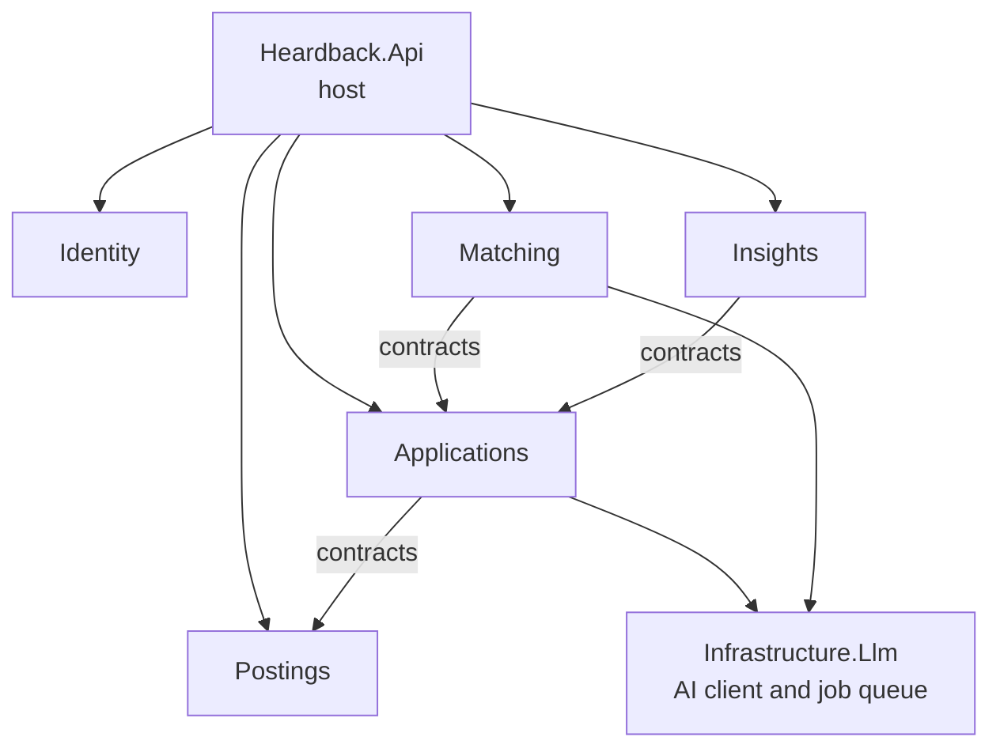

# Heardback

*Named after the question every job seeker asks: "Did I hear back?"*

A web app for job seekers: track every application in one place and see what the data says, instead of
guessing. Which channels get answers, how long companies take to reply, how well your CV matches a posting, and
which postings nobody ever hears back from.

**Live: [heardback-app.netlify.app](https://heardback-app.netlify.app)**. Press **Try the demo** on the sign-in
page to look around with sample data; nothing to sign up for, and the demo is deleted after a day. Real
accounts are invite only, for a small group of people who know each other.



## What it does

- **Track applications** as a list or a board: company, role, channel, the posting text and a dated timeline
  of what happened (interview, offer, rejection, notes). "No response · 31 days" is worked out from the dates.
- **Overview:** applications per week, response rate per channel, time to the first reply, how far
  applications got, and a follow-up list of the ones that went quiet.
- **CV match:** upload a CV once; each application shows which of the posting's skills your CV has and which it
  lacks. Only the text is kept, with contact details removed, and the PDF is never stored.
- **AI help, opt-in:** summarise a posting (company, seniority, work mode, skills) and get concrete,
  checkable suggestions for tailoring your CV to one application. Suggestions quote the CV line they are about.
- **What other members saw:** for the same posting or company, how many other members heard back and how long
  it took, plus a warning, with its reasons, when a posting looks like one where nobody ever hears back. Shown
  only once at least three other members applied, and only as totals, never names.
- **Your data:** download everything, delete your account, and a plain-language privacy page.

| Board | Overview |
|---|---|
|  |  |
| **CV and skills** | **Company page with community numbers** |
|  |  |

**On a phone:** every screen works on a phone too, in light and dark mode.

| Applications | Application detail | Overview |
|:---:|:---:|:---:|
|  |  |  |

## Tech stack

- **Backend:** .NET 10, ASP.NET Core minimal APIs, EF Core, PostgreSQL 18, a modular monolith
- **Frontend:** Angular 22 (standalone, signals, zoneless), Angular CDK, Tailwind CSS v4, a custom design
  system ([docs/design.md](docs/design.md)), light and dark
- **AI:** Groq with Gemini as fallback, behind one interface, JSON-schema answers, strict daily limits
- **Tests:** xUnit v3, Testcontainers (real Postgres), architecture tests, Vitest
- **Hosting:** Netlify (web), Fly.io (API), Neon (Postgres); GitHub Actions CI and Dependabot

Built with AI assistance (Claude Code), with every change reviewed by the author and about 1,200 tests run in
CI on every pull request; see [How this was built](#how-this-was-built).

## Architecture at a glance





Each module that stores data owns its own Postgres schema, and every module exposes only a small contracts
namespace; architecture tests fail the build if one module reaches into another's internals. Every user-owned
row is filtered to the signed-in user by a global query filter, with integration tests proving the isolation.

**Decisions worth reading** (all in [docs/adr](docs/adr)):

| Topic | Record |
|---|---|
| Modular monolith with hard boundaries | [ADR-0001](docs/adr/0001-modular-monolith.md) |
| Sessions, rotating refresh tokens, rate limits, client IP behind a signed proxy | [ADR-0002](docs/adr/0002-authentication-and-sessions.md) |
| Shared job postings, deduplicated across users without leaking them | [ADR-0004](docs/adr/0004-shared-job-postings.md) |
| CV upload: text only, PII removed, decompression limits | [ADR-0006](docs/adr/0006-cv-upload-and-text-extraction.md) |
| LLM features: provider fallback, schemas, quotas, no training on CV text | [ADR-0008](docs/adr/0008-llm-features.md) |
| Community signals that never reveal an individual | [ADR-0013](docs/adr/0013-community-signals.md) |
| Account deletion, data export and recovery without email | [ADR-0015](docs/adr/0015-account-deletion-export-and-recovery.md) |
| "Try the demo": sandboxes, limits, kept apart from members | [ADR-0018](docs/adr/0018-demo-accounts.md) |

The engineering rules every change follows are in [CLAUDE.md](CLAUDE.md), and the roadmap is in [PLAN.md](PLAN.md).

## Running locally

Prerequisites: .NET 10 SDK, Node 22 (see `.nvmrc`) with npm 12 (`npm install --global npm@12.2.0`, the
version CI uses), Docker.

### One-time setup

```bash
# Database credentials for docker compose
cp .env.example .env              # then set POSTGRES_PASSWORD

# API secrets (stored outside the repo with dotnet user-secrets)
cd src/Heardback.Api
dotnet user-secrets set "Database:ConnectionString" \
  "Host=localhost;Port=5432;Database=heardback;Username=heardback;Password=<POSTGRES_PASSWORD>"
dotnet user-secrets set "Identity:Tokens:SigningKey" "$(openssl rand -base64 48)"
# 12 characters, the same shape as an invite code (hex digits are all valid invite characters)
dotnet user-secrets set "Identity:Invites:BootstrapAdminCode" "$(openssl rand -hex 6)"
# Optional: AI features. Without any key they are off and everything else works.
dotnet user-secrets set "Llm:Groq:ApiKey" "<key from console.groq.com>"
dotnet user-secrets set "Llm:Gemini:ApiKey" "<key from aistudio.google.com>"   # fallback
cd ../..
```

In production the same settings come from environment variables (`Llm__Groq__ApiKey`,
`Llm__Gemini__ApiKey`). Models, timeouts and which provider may receive CV text are in the `Llm` settings
section ([ADR-0008](docs/adr/0008-llm-features.md)).

### Run

```bash
docker compose up -d                       # Postgres 18
dotnet run --project src/Heardback.Api      # API on http://localhost:5080 (Scalar at /scalar); migrates on start
cd web && npm ci && npm start              # app on http://localhost:4200, proxies /api to the API
```

### First admin

Registration needs an invite code. The very first account uses the bootstrap code from user-secrets
(`dotnet user-secrets list --project src/Heardback.Api | grep BootstrapAdminCode`): open
`http://localhost:4200/register`, enter it as the invite code, and that account becomes the admin. After
that the bootstrap code stops working; remove the setting. The admin creates invite codes for everyone
else on the **Members** page (`/admin/members`), under Invite codes.

The bootstrap code must look like an invite code: 12 characters from 0-9 and A-Z without I, L, O or U
(dashes are fine). The API refuses to start otherwise, with a message that says how to generate one.

To try things out quickly, the admin sees **Add sample applications** on the Applications page: it adds
eight realistic applications with posting text to the admin's own list. It is on only where
`Applications:SampleDataEnabled` is true (`appsettings.Development.json`), never by default in production.

### Demo accounts

**Try the demo** on the sign-in page creates a temporary account with sample applications and a sample CV, no
invite or password needed ([ADR-0018](docs/adr/0018-demo-accounts.md)). It is removed with its data after a day.
Demo visitors cannot open admin pages or change a password, get small AI quotas (3 job summaries and 2 CV
suggestion requests a day), and see community numbers only from four permanent made-up "neighbor" accounts;
members never see any demo account in their numbers. At most
20 demos exist at once, and each IP can start 3 an hour. Settings are under `Identity:Demo`; it is off unless
`Identity:Demo:Enabled` is true (production turns it on in `fly.toml`). To try it locally:

```bash
dotnet user-secrets set "Identity:Demo:Enabled" "true" --project src/Heardback.Api
```

### Forgotten passwords

There is no email. An admin opens **Members** (`/admin/members`), sees the member's email and creates a
one-time reset code there. The member enters it with a new password under **Forgot your password?** on the
sign-in page, which opens `/reset-password`.
Codes work once and expire after 24 hours. Admins cannot reset other admins; the owner does that on the
server, where the API binary doubles as a command line tool and never starts the web server for these:

```bash
dotnet run --project src/Heardback.Api -- reset-code someone@example.com   # prints a code, admins included
dotnet run --project src/Heardback.Api -- list-admins                      # names and emails of the admins
```

In production run them inside the API's machine (see [Deploying](#deploying)):
`fly ssh console -C "dotnet /app/Heardback.Api.dll reset-code someone@example.com"`.

### Adding a database migration

```powershell
./scripts/Add-Migration.ps1 -Module Identity -Name DescriptiveName   # -Module Llm for the job table
```

The script runs `dotnet ef` and makes the generated classes `internal`, so modules keep exposing only
their contracts. Review the migration before committing, and never edit one that has been applied. A
test fails if a module's model has changes that no migration captures yet.

## Deploying

The hosting is drawn in [Architecture at a glance](#architecture-at-a-glance). The browser only ever talks
to Netlify, so the app and the API share one origin and the refresh cookie stays first-party. Netlify signs every request it forwards to Fly.io; the API refuses anything unsigned
except `/health`, and takes the client IP for rate limiting from Netlify's header
([ADR-0002](docs/adr/0002-authentication-and-sessions.md)). All three run on free or near-free tiers: the
Fly.io machine stops when idle and starts on the next request (a few seconds), and Neon does the same.

### 1. Database (Neon)

Create a project in the Frankfurt region. From **Connect**, take the *direct* (not pooled) connection
details and write them in Npgsql form:

```
Host=<ep-...>.eu-central-1.aws.neon.tech;Database=<db>;Username=<user>;Password=<password>;SSL Mode=Require;Channel Binding=Require;GSS Encryption Mode=Disable
```

`GSS Encryption Mode=Disable` stops Npgsql from looking for Kerberos libraries, which the chiseled image
does not have (harmless, but it logs an error on every connection otherwise).

### 2. API (Fly.io)

`fly.toml` and the `Dockerfile` are in the repository root. App names are global; if `heardback-api` is
taken, change `app` in `fly.toml` and the proxy target in `netlify.toml`.

```bash
openssl rand -hex 6     # bootstrap code: note it, you sign up with it
openssl rand -hex 32    # signature secret: note it, Netlify needs the same value
fly apps create heardback-api
fly secrets set --app heardback-api \
  "Database__ConnectionString=<Npgsql connection string>" \
  "Identity__Tokens__SigningKey=$(openssl rand -base64 48)" \
  "Identity__Invites__BootstrapAdminCode=<bootstrap code>" \
  "ClientIp__Netlify__SignatureSecret=<signature secret>" \
  "Llm__Groq__ApiKey=<key>" "Llm__Gemini__ApiKey=<key>"
fly deploy --ha=false                               # one machine: rate limits and migrations assume it
curl https://heardback-api.fly.dev/health          # Healthy; any other path answers 403
```

Migrations run when the API starts.

### 3. Web app (Netlify)

Import the GitHub repository as a new site; build settings come from `netlify.toml`. Then, in the site
settings:

- Environment variables: `API_SIGNATURE_SECRET` = the same secret as `ClientIp__Netlify__SignatureSecret`,
  with a scope that includes **Runtime** (Netlify reads it for signed proxy rewrites).
- Deploy previews: off, so only `main` builds. Builds are skipped when nothing under `web/`
  (or `netlify.toml`, `.nvmrc`) changed.
- Site name: `heardback-app` (gives `heardback-app.netlify.app`; `heardback` was taken).

Register the first admin at `/register` with the bootstrap code, then remove it:
`fly secrets unset --app heardback-api Identity__Invites__BootstrapAdminCode`.

### 4. Check the client IP once after the first deploy

Netlify documents the signature but not which header carries the client IP, nor whether it overwrites a
copy sent by the client. This check proves both, using the sign-in limit (10 attempts a minute per IP):

1. From your computer, try to sign in with a wrong password 11 times within a minute. The 11th answers
   *Too many attempts*. (If every request fails instead, `fly logs` shows `MissingClientIp`: set
   `ClientIp__Netlify__ClientIpHeader` to the header Netlify really sends.)
2. Within the same minute, from a phone on mobile data, a wrong password still answers *Email or password
   is incorrect*. Each client has its own budget, so the header holds the client's IP, not Netlify's.
3. Within the same minute, from your computer again, send a forged header:
   `curl -i -X POST https://heardback-app.netlify.app/api/auth/login -H "Content-Type: application/json" -H "X-Nf-Client-Connection-Ip: 198.51.100.1" -d '{"email":"a@example.com","password":"wrong-password-1"}'`.
   It must still answer 429. If it answers 401, Netlify passed the forged header through: stop and fix
   before inviting anyone.

## Architecture in detail

Heardback is a **modular monolith**: one deployable API, split into modules with hard boundaries
([ADR-0001](docs/adr/0001-modular-monolith.md)).

```
src/
  Heardback.Api/                  host: DI, middleware, maps module endpoints
  Heardback.Modules.Identity/     users, invite codes, sessions, account deletion/export, recovery, demo accounts
  Heardback.Modules.Applications/ applications, timelines, posting analysis, cross-user counts, demo data
  Heardback.Modules.Postings/     shared job postings, dedup
  Heardback.Modules.Matching/     CV text, skills, match results, CV tailoring
  Heardback.Modules.Insights/     personal stats, the follow-up list and community signals
  Heardback.Infrastructure.Llm/   LLM client, providers and the Postgres job queue
  Heardback.Shared/               Result type, current user, paging, module DbContext base, validation
tests/
  Heardback.UnitTests/            unit and architecture tests
  Heardback.IntegrationTests/     API and database tests (Testcontainers)
web/                             Angular app
docs/adr/                        architecture decision records
docs/design.md                   design system: tokens, type, components, screen states
```

- **Module boundaries:** each module exposes only its `Contracts` namespace and one registration class;
  everything else is `internal`. Architecture tests fail the build if a module uses another module's
  non-contract types.
- **Data:** each module owns its own Postgres schema (snake_case) and never reads another module's tables.
- **Per-user isolation:** module DbContexts filter every user-owned entity to the current user and
  refuse writes to other users' rows. Architecture tests catch entities that skip this.
- **Auth** ([ADR-0002](docs/adr/0002-authentication-and-sessions.md)): invite-only registration,
  15-minute JWT access tokens kept in memory, and rotating refresh tokens in an httpOnly cookie.
  Sessions have an absolute 60-day limit, reusing a rotated token signs the user out everywhere, and
  the auth endpoints are rate limited per IP. Every endpoint requires sign-in unless marked anonymous.
- **Shared postings** ([ADR-0004](docs/adr/0004-shared-job-postings.md)): the same job is recognised
  across users by its normalized link or a hash of its content, safely under concurrent submissions.
  Postings are never edited and hold no user id; each application keeps the user's own copy of the
  details. The server never fetches posting pages.
- **Applications:** each application has a timeline of dated events; its status is the latest status
  event, and "No response · N days" is derived from dates on every read. Edits carry the row version and
  fail with 409 when the application changed elsewhere. Writes are rate limited per user. The web app
  shows applications as a list or as a board; a board move is a status event dated today, made by
  dragging a card or with "Move to…" (keyboard, touch and screen reader users).
- **CVs** ([ADR-0006](docs/adr/0006-cv-upload-and-text-extraction.md)): a user uploads one CV PDF. The
  server reads its text in memory under strict limits (size, pages, a decompression budget, an hourly upload
  limit), replaces emails, phone numbers, links and address lines with markers, and stores only that text;
  the file itself is never stored.
- **Matching:** a dictionary of about 125 skills (with aliases such as "dotnet" for .NET) finds the skills
  an application's role and posting text name and those the CV shows, and lists matched and missing
  skills with a score. Deterministic, no LLM, worked out on every read. A text dictionary cannot tell "I know
  Rust" from "my project checks Rust code", so users can mark a found skill as not theirs.
- **LLM client** ([ADR-0008](docs/adr/0008-llm-features.md)): one `ILlmClient` tries Groq, then
  Gemini on rate limits, server errors and timeouts, with plain HTTP calls and JSON schema output.
  Requests containing CV text never go to a provider whose terms allow using them (Gemini's unpaid tier).
  Each call logs provider, model, prompt id, latency and token counts, never prompt or answer text.
  Prompts are versioned classes with a typed answer; the JSON schema is generated from the answer type,
  answers are parsed strictly and checked, and an unusable answer is retried once before it counts as failed.
- **Posting analysis:** on the user's request, an LLM reads the application's own posting text (personal
  details removed) into company, title, seniority, work mode, skills and location. Results are shared by
  content hash, so identical text is analysed once; adding a posting never calls the LLM. Daily limits per
  user (30 posting analyses, 10 tailoring requests) and an app-wide cap on LLM calls protect the free tiers;
  a failed job gives its use back.
- **CV tailoring:** with the user's opt-in, an LLM suggests 3-6 concrete changes that rework what the CV
  already says for one application. Each suggestion quotes the CV line it is about; suggestions whose quote
  is not in the CV, or that name a skill the CV lacks, are dropped. Missing keywords come from the
  deterministic match. Withdrawing the opt-in, deleting the CV or deleting the application deletes the
  suggestions; a job runs as the user who asked, under the same per-user filters.
- **Personal insights** ([ADR-0011](docs/adr/0011-personal-insights.md)): `/api/insights/dashboard` gives
  applications per week, response rate per channel, time to first response and a funnel; `/api/insights/follow-ups`
  lists applications with no response, longest silence first. The Overview page (`/overview`) shows both with hand-drawn SVG charts. Worked out on every read from the user's own
  applications through a read-only Applications contract; nothing is stored and no LLM is used.
- **Community signals** ([ADR-0013](docs/adr/0013-community-signals.md)): `/api/community/*` shows how other
  members fared with the same posting and company (members, response rate, days to first answer) and an
  explainable ghost-listing hint (0-5 points, each with its reason). Numbers appear only once at least 3 other
  members have a settled application in the group; the viewer is never counted, and only postings and
  companies the viewer tracks can be asked about. One Applications contract is the single cross-user read and
  returns counts only. In the app, Medium and High hints show as badges in the list and board, the
  application detail has a Community section, and each company you applied to has its own page.
- **Privacy & recovery** ([ADR-0015](docs/adr/0015-account-deletion-export-and-recovery.md)): members can
  download all their data as one JSON file (`GET /api/account/export`) and delete their account
  (`DELETE /api/account`, password required), both from the Settings page (`/settings`), which also changes
  the password and the theme. The public privacy page (`/privacy`) says what is kept, who sees it and what
  goes to AI providers. Every module erases its own data through one Shared contract;
  a posting text is deleted with the last application that uses it, guarded by a per-posting advisory lock.
  A test scans every table with a user id column after a deletion. A new password (reset code or change)
  ends every session, and access tokens of a deleted account or older than the last password change are
  rejected.
- **Demo accounts** ([ADR-0018](docs/adr/0018-demo-accounts.md)): "Try the demo" creates a sandbox with sample
  data through every module's own seeding contract, limited to 3 per IP an hour and 20 at once (checked under
  an advisory lock). Demo visitors get small AI quotas (3 job summaries, 2 tailoring requests a day), cannot
  reach admin pages or set a password, and see community numbers only from four permanent made-up accounts,
  so nothing derived from members ever reaches an anonymous visitor. A hosted service removes them after a
  day, the same way an account deletion does.
- **Background jobs:** LLM work runs from a Postgres job table (`llm` schema) processed by an in-process
  worker. Jobs hold only ids and hashes, never user text. Claims use row locks and leases, so jobs run
  once even with several instances and survive a crash; failures retry with backoff and then fail.
- **Errors and validation** ([ADR-0003](docs/adr/0003-request-validation.md)): RFC 9457 ProblemDetails
  everywhere, 400 with field-level errors for invalid requests, and configuration validated at startup.

## How this was built

Heardback is developed with AI assistance (Claude Code). The architecture and technical decisions are
the author's, and every change is reviewed by the author before it is merged.

Every change ships with tests: about 800 .NET tests (unit, architecture, and integration tests against a real
PostgreSQL in Docker) and about 400 web tests, all run in CI on every pull request. Work is done in small,
reviewed pull requests with conventional commits, and significant decisions are written down as ADRs.
